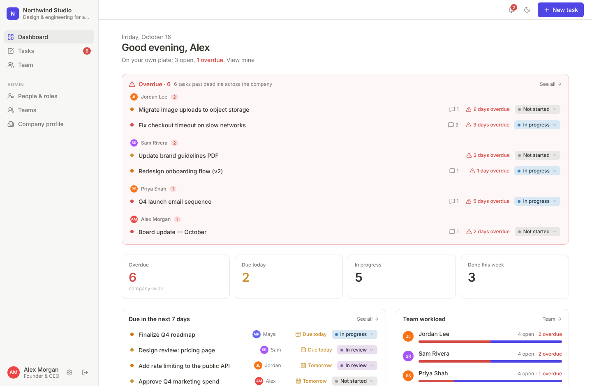
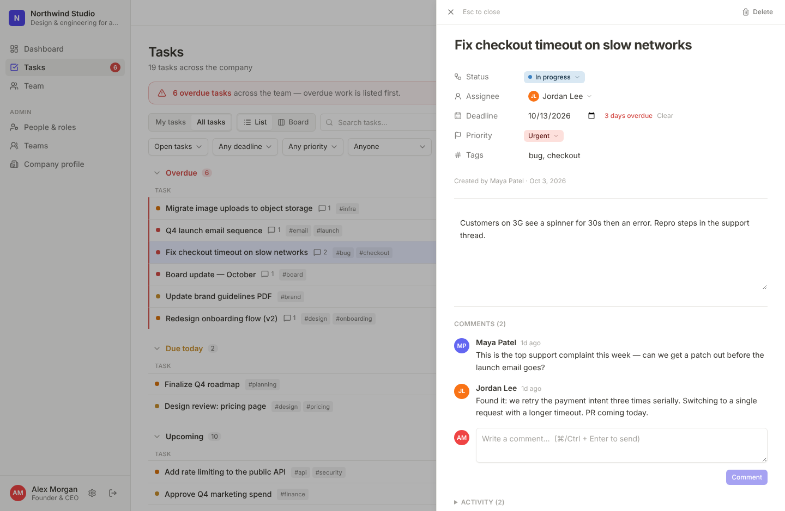
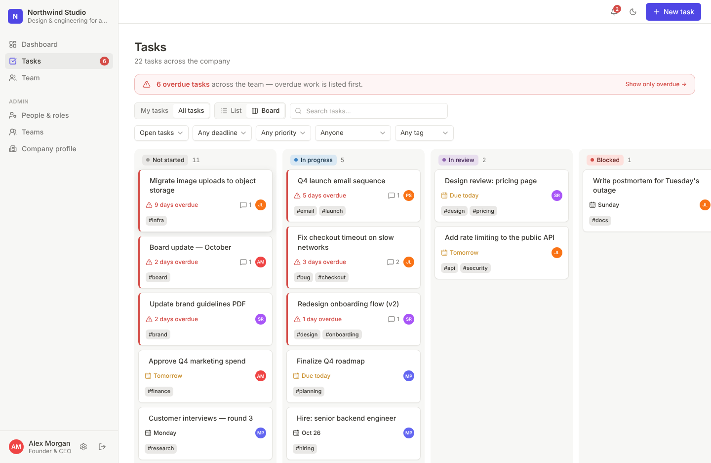

# Task Manager

A calm, Notion-style task manager for small teams. The founder/admin sets up the company, adds people and roles, and assigns work. Everyone else gets a clean dashboard where **overdue work is always the first thing they see**.

Built with **Next.js 16 (App Router) · React 19 · Tailwind v4 · Drizzle ORM · PostgreSQL**. Deploys to Vercel with no code changes.



| Task side-peek | Board |
| --- | --- |
|  |  |

## What you get

**For the admin / founder**
- **Company profile** – name, tagline, about, logo, website, industry, size, founded year, timezone, brand colour (recolours the whole app) and a task-visibility policy.
- **People & roles** – add team members (auto-generated temporary password, shown once), change roles, assign teams, reset passwords, deactivate/reactivate (live sessions are killed immediately). The last active admin can never be demoted or deactivated.
- **Teams** – group people (Engineering, Design, …).
- **Assign tasks** to anyone; see **company-wide overdue work grouped by person**, per-person workload, blocked work, completion trend and a live activity feed.

**For the team**
- A Notion-like workspace: **List** (grouped *Overdue → Due today → Upcoming → No deadline → Completed*) and **Board** (drag cards between status columns).
- **Side-peek panel** for each task: status, assignee, deadline, priority, tags, description, **comments** and full change history – all editable inline.
- **Overdue first, everywhere** – the dashboard opens with an Overdue panel, the Tasks page sorts and groups overdue first and shows a banner, and the sidebar carries a live overdue badge. Founders see the same, company-wide.
- Filters and search that live in the URL (shareable), in-app **notifications** (assigned, commented, status changed, overdue), dark mode, keyboard shortcut `c` for a new task, mobile-friendly layout.

### Roles

| | Admin | Manager | Member |
| --- | :-: | :-: | :-: |
| Company profile, people, roles, teams | ✅ | – | – |
| Create tasks & assign to others | ✅ | ✅ | – (own tasks only) |
| Edit / delete any task | ✅ | ✅ | only tasks they created |
| Change status | any task | any task | tasks assigned to them |
| See all tasks | ✅ | ✅ | per company setting (all, or only theirs) |
| Comment | ✅ | ✅ | on tasks they can see |
| Team workload view | ✅ | ✅ | – |

Every rule is enforced **on the server** (`src/lib/permissions.ts` + each action) – hiding a button is never the only protection.

### Extra ideas included beyond the brief
- **Overdue banner + badge + daily digest** – a Vercel Cron job notifies the assignee (and creator) once when a task slips past its deadline.
- **Member task visibility policy** (transparent vs. need-to-know) as a company setting.
- **Claim an unassigned task** with one click; members can add personal tasks.
- **Forced password change** on first sign-in; password change signs out other devices.
- **Sample data option** on first-run setup so you can explore immediately.
- Brand-colour theming, 14-day completion chart, workload bars, activity feed.

## Deploy to Vercel

1. **Import the repo** at [vercel.com/new](https://vercel.com/new). The framework (Next.js) is auto-detected.
2. **Add a Postgres database**: *Storage → Create → Neon* (or Supabase / any Postgres) and connect it to the project. Make sure a **`DATABASE_URL`** environment variable exists (use the *pooled* connection string if your provider has both).
3. **Add environment variables** (Project → Settings → Environment Variables):

   | Name | Required | Purpose |
   | --- | :-: | --- |
   | `DATABASE_URL` | ✅ | Postgres connection string (pooled — see Supabase note below) |
   | `MIGRATION_DATABASE_URL` | optional | Direct/session connection used only for build-time migrations; falls back to `DATABASE_URL` |
   | `AUTH_SECRET` | ✅ | Signs session cookies. Generate with `openssl rand -base64 48` |
   | `SETUP_KEY` | recommended | If set, `/setup` asks for it – stops a stranger claiming a freshly deployed instance before you do |
   | `CRON_SECRET` | for digests | Vercel sends it as a bearer token to `/api/cron/overdue`; without it the endpoint returns 401 |
   | `BREVO_SMTP_LOGIN`, `BREVO_SMTP_KEY`, `EMAIL_FROM` | for email | Turn on [assignment emails](#email-notifications). All three are required; leave them unset and no email is sent |
   | `APP_URL` | recommended with email | Public URL used for the "Open task" link in emails (falls back to the host of the request) |

4. **Deploy.** The build runs `node scripts/migrate.mjs` first, so the schema is created/updated automatically on every deploy (and the build fails loudly if `DATABASE_URL` is missing).
5. Open your URL → **/setup** → create the company and your admin account. Add teammates from **People & roles**.

> **Supabase:** use the **pooler** connection string (*Dashboard → Connect → Transaction pooler*, host `aws-0-<region>.pooler.supabase.com`, port `6543`, user `postgres.<project-ref>`) and append `?sslmode=require`. The *Direct connection* host (`db.<ref>.supabase.co`) is IPv6-only and Vercel can't reach it — builds fail fast and `/api/health` reports `ENOTFOUND`. For migrations you can set `MIGRATION_DATABASE_URL` to the **Session pooler** (port `5432`). Migration `0001` turns on Row Level Security (no policies) for every table so Supabase's public REST API can't expose app data; the app connects as the table owner, which bypasses RLS.
>
> **Troubleshooting:** `GET /api/health` returns `{"ok":true}` when the database is reachable. Send `Authorization: Bearer $CRON_SECRET` to also get the failing error code and whether the DB host resolves over IPv4/IPv6. `SKIP_DB_MIGRATE=1` skips build-time migrations (use sparingly).
>
> **Previews:** preview deployments use the same env vars by default. Scope `DATABASE_URL` to *Production* and give previews their own database (e.g. a Neon branch) so test data and migrations never touch production.
>
> **Cron:** `vercel.json` schedules `/api/cron/overdue` daily at 06:00 UTC (fits the Hobby plan limit of one run per day).

## Email notifications

When someone assigns (or reassigns) a task, the new assignee gets an email with the task title, a short description, priority, deadline and an **Open task** link. It goes out through [Brevo](https://www.brevo.com)'s SMTP relay *after* the request has finished, so a slow or failing mail server never blocks or fails the action. As with in-app notifications, you aren't emailed about tasks you assign to yourself.

Set it up:

1. In Brevo, **verify your sender** (a single address, or better an authenticated domain with SPF/DKIM) so mail isn't flagged as spam.
2. Brevo → **SMTP & API → SMTP**: copy the **Login** and generate an **SMTP key** (this is *not* the API key).
3. Set `BREVO_SMTP_LOGIN`, `BREVO_SMTP_KEY` and `EMAIL_FROM` (e.g. `Acme <tasks@acme.com>`), plus `APP_URL`, then redeploy.

Delivery problems are logged as `[email] couldn't send assignment email` (Vercel → project → Logs). If your network blocks port 587, set `BREVO_SMTP_PORT=2525`.

## Run locally

```bash
npm install
npm run dev          # http://localhost:3000 → redirects to /setup
```

No database setup needed: with no `DATABASE_URL`, development uses an embedded Postgres ([PGlite](https://pglite.dev)) stored in `./.data`. Want demo content?

```bash
npm run db:reset && npm run db:seed   # stop `next dev` first
# founder@example.com / demo1234  (admin) · maya@ (manager) · jordan@ sam@ priya@ (members)
```

To develop against a real Postgres instead, copy `.env.example` to `.env.local` and set `DATABASE_URL`, then `npm run db:migrate`.

| Script | |
| --- | --- |
| `npm run dev` / `build` / `start` | Next.js |
| `npm test` | Unit tests (overdue/timezone logic, permission matrix) |
| `npm run typecheck` / `lint` | TypeScript / ESLint |
| `npm run db:generate` | Create a SQL migration after editing `src/lib/db/schema.ts` |
| `npm run db:migrate` | Apply migrations to `DATABASE_URL` |

## How it's put together

```
src/
  app/                    routes — (auth) login/setup/change-password · (app) dashboard, tasks, team, settings, admin/*
  app/api/cron/overdue    daily overdue notifier
  components/             ui primitives · layout · tasks (table, board, peek) · admin
  lib/db/                 Drizzle schema, DB client (Postgres | PGlite), sample data
  lib/data/               read queries (visibility + "overdue first" ordering live here)
  lib/actions/            server actions: validate (zod) → authorise → write → revalidate
  lib/permissions.ts      the role/permission rules (pure, unit-tested)
  lib/dates.ts            deadline & timezone logic (pure, unit-tested)
  proxy.ts                redirects signed-out visitors (Next 16's replacement for middleware)
drizzle/                  generated SQL migrations (committed)
```

Design decisions worth knowing:

- **Deadlines are calendar dates** (`YYYY-MM-DD`) interpreted in the *company timezone*, so "overdue" flips at local midnight for everyone and string comparison is always correct. Set the timezone in **Company profile**.
- **Auth** is custom and small: bcrypt password hashes, a signed JWT in an `httpOnly`, `SameSite=Lax`, `Secure` cookie, **re-validated against the database on every request** (so deactivation and password resets take effect instantly). Accounts lock for 15 minutes after 5 failed attempts. Open redirects after login are blocked.
- **Single tenant**: one company per deployment. Deploy a second project for a second company.
- **Serverless-friendly DB access**: `postgres.js` with `prepare: false` and one connection per instance, safe behind Neon/Supabase poolers.
- Security headers are set in `next.config.ts`. There is deliberately no CSP yet (it needs nonce plumbing for Next's inline scripts).

## Known limits / next steps

- **Email is assignment-only**: new users still get a temporary password you hand over (shown once); invitation / password-reset / comment / overdue emails aren't sent yet.
- No file attachments, subtasks, recurring tasks or @mentions yet.
- Drag-and-drop on the board is mouse/pen only; on touch devices and for keyboard users, change status from the task panel or the status pill.
- Sessions last 7 days; there is no "remember me" / SSO.
